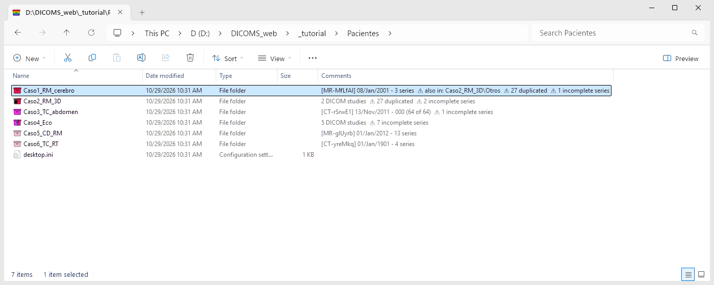
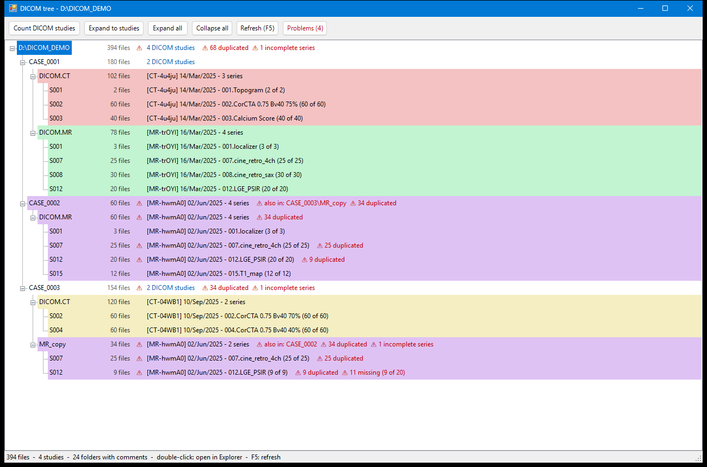
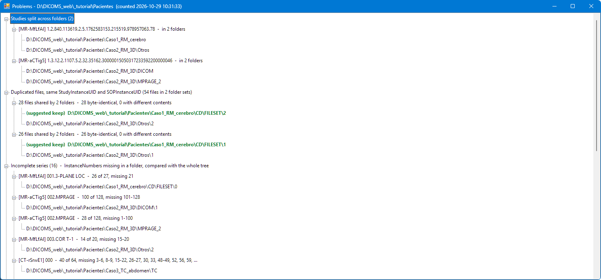

# explorer4dicoms

**Windows Explorer for a bag of DICOM files.**

DICOM files come the way they come: a CD, an export from a PACS, a download, a disk with years of
studies - thousands of files named `IM0001` in folders that say nothing, copies of copies, studies
split across folders. explorer4dicoms does not move, rename or reorganize any of them. It reads their
headers and shows you the order they have inside: which patients, studies, series and volumes there
are, where each one is, what is missing, what is duplicated and what is put together wrongly. The
files stay as they are; what changes is what you can see of them. Hence the plural: it is about all
those DICOMs you have, not about one file.

It works in two places at once, hence the rest of the name: in **Windows Explorer** itself (comments
and colored icons on the folders, DICOM columns, thumbnails and preview of the files) and in its own
**DICOM explorer**, a window with the tree of the whole bag (patient, study, series, orientation,
position, image), its images, their full headers, a 3-D navigator of where every image is in the
patient, their segmentations and the checks of every series.

Find duplicated DICOM files and badly organized folders straight from Windows Explorer:

Right-click a folder and choose **DICOM > Count studies**: every folder and subfolder gets a summary
in Explorer's **Comments** column (studies, date, series) together with warnings for the problems
found: studies split across folders, duplicated images, incomplete series and copies in other
locations. Folders with DICOM get an archive box icon in the color of their study. **DICOM > Show
tree** opens the whole folder tree with one color per study.







*Screenshots made with synthetic data generated by [`docs/New-DemoArchive.ps1`](docs/New-DemoArchive.ps1).*

## Features

- **One header read per file.** Only the DICOM header is read (up to InstanceNumber, tag 0020,0013),
  never the pixel data. Supports Explicit/Implicit VR Little Endian, Explicit VR Big Endian, Deflated
  and "raw" files without preamble. Non-DICOM files are ignored. Parallel reading.
- **Comments column in Explorer**, written in every folder:

  | Folder contents | Comment |
  |---|---|
  | several studies | `4 DICOM studies` |
  | one study | `[MR-FhwmA0] 02/Jun/2025 - 4 series` |
  | one study, one series | `[MR-FhwmA0] 02/Jun/2025 - 007.cine_retro_4ch (25 of 25)` *(DICOM files of all files)* |
  | files, but no DICOM | `(0 DICOMs of 12 files)` *(files of the whole subtree)* |
  | no files at all (subfolders included) | `---` |

  `[MR-FhwmA0]` is the study tag: the study's main image modality plus 6 case-sensitive characters
  (digits and letters, 62 possible each: 56,800 million tags) from a hash of the StudyInstanceUID, so
  the same study always has the same tag in every folder and run. Earlier versions used 5 characters:
  they are the last 5 of the 6 (`hwmA0` became `FhwmA0`), and those comments keep them until counted
  again.
- **Problems** (appended to the comments with `⚠`, and listed in the tree's *Problems* window):
  - **Study split across folders**: the same study in more than one separate folder.
  - **Duplicated files**: same StudyInstanceUID and SOPInstanceUID, then same size, then a full
    byte-by-byte comparison (all the copies read side by side in a single pass, stopping at the first
    difference), so two different files can never produce a false duplicate. Copies with different
    contents are reported apart.
  - **Incomplete series**: a folder missing InstanceNumbers of a series, compared with the whole tree
    (e.g. a partial copy of a series that is complete elsewhere).
  - **Copies in other counted locations**: every count keeps an index of its files (path, size, date
    and time, study and image UIDs); copies found in other counted folders or disks are confirmed with
    the same byte-by-byte comparison. Entries of deleted or replaced files are dropped from the index.
- **Folder icons in the colors of the studies** (Name column, and every other view of Explorer): an
  archive box instead of a folder, so folders with DICOM stand out whatever their color:
  - one study: a box of the study's color, always the same for the same study (22 colors told
    apart at 16 px, from a hash of the StudyInstanceUID, including black, white and three grays);
  - 2 to 5 studies: vertical stripes of their colors, in date order;
  - more than 5 studies: horizontal rainbow stripes.

  The icon does not mark problems, so it never hides the colors: they are marked in the comment.

  Folders without DICOM keep the normal folder icon, and a custom icon set by someone else is never
  replaced.
- **Icons of the DICOM files**: every DICOM file shows its SeriesNumber in the color of its
  study (the color of its box), on the complementary color (made darker or lighter when the number
  would not read well on it). DICOMDIR and other files keep their usual icon. It is an icon handler,
  a small C++ DLL (`bin\DicomShell.dll`) that Explorer asks for the icon of `.dcm`, `.ima` and
  `.dicom` files and of files without extension; it reads only the header, up to SeriesNumber, and
  never writes to them. Windows chooses handlers by extension only: the DLL then looks inside each
  file (the `DICM` at byte 128, or a raw dataset) and leaves the files that are not DICOM as they were.
- **Thumbnails** (medium icons and larger, unless *Always show icons, never thumbnails* is on): the
  first frame, with the series icon as a badge in its lower right corner. DICOM files without an image
  (reports, DICOMDIR) keep their icon. Smaller (details, list, small icons): the series icon, not
  the thumbnail.
- **Preview of the DICOM files** (Explorer's preview pane, Alt+P): three tabs over the image.
  - *Columns*: every DICOM column with its value for this file, and a check box that shows or hides
    that column in the Explorer window of the folder (as *right-click a column header > More...*
    would; Explorer keeps it with the folder's view).
  - *Header*: the whole header, one line per attribute, with its name from the DICOM dictionary
    (`PatientName`).
  - *Tags*: the same with its tags (`(0010,0010)`). Ctrl+T switches between the two headers.

  Text and rows can be selected and copied (Ctrl+A, Ctrl+C). The tab chosen is remembered for each
  folder. The image is the first frame, with the window of its header. Dragging over it changes the
  window: right widens it (less contrast), up makes it brighter. Dragging with the right button zooms
  around where it started (up: in, down: out); dragging with the middle button, or Shift and the left
  one, moves the zoomed image. A double click goes back to the header's window, fitted. The bar
  between the tabs and the image moves (remembered for every preview).

  Under the image, a bar of two rows, each with its button and its slider, gray when there is nothing
  to go through. The first one, the times: the frames of a multi-frame file, its play button the cine
  (at the pace of the file). The second one, the places: the slices of its series (the files of the
  folder with its SeriesInstanceUID, in the order of their Z level, then of their InstanceNumber), its
  button (three planes, one behind the other) jumping through them at 10 a second. After a click on the
  image, the keys do the same: Left / Right the times, Up / Down and Page Up / Page Down the places,
  Home / End, and Space the cine (or the jumps, when there are no times; also the wheel, when Explorer
  lets it reach the preview: it usually keeps it for its list of files). The window dragged stays from slice to slice; the header and the values of the columns
  follow the slice shown when the stepping stops. The series is read in the background, once per
  folder while it does not change.

  The *Overlay* check box of that bar (remembered) writes on the image what viewers show in its
  corners, never who the patient is: modality, series, description and image number; date and time,
  device and protocol; Z level, slice thickness, pixel spacing and size; the window and zoom; and the
  patient directions at the sides (R/L, A/P, H/F, from ImageOrientationPatient).

  Its **segmentations** are drawn over it, with a *Segmentations* check box under *Overlay* (remembered,
  only when the image has any): the DICOM SEG and RT Structure Sets of its study found in its folder, in
  the folders in it and in the folders beside it (a study exported with a folder for each series) - the
  masks of the SEG frames in its plane, faint inside and strong at the edge, in the color of each
  segment, and the contours of the structure sets in its plane, in the color of each ROI - read in the
  background, once while those folders do not change. The **overlay planes** of the image count as
  segmentations too (groups 60xx: annotations, ROIs, CAD marks, labels the device or a workstation
  drew), whether they come in their own OverlayData or hidden in the high bits of the pixels: the first
  one in magenta and the others in colors of their own. A file broken in a way that makes reading its
  planes fail is shown without them. ACR-NEMA files (the format before DICOM) without the attributes DICOM asks for
  are read as DCMTK reads them.

  A **DICOMDIR** opens on a *Directory* tab: its patients (by ID, never by name), studies, series (by
  number, with how many files) and files. Choosing a file shows it under the tree, with the slider
  over its series; Enter or a double click opens its folder in Explorer with the file selected. The
  DICOMDIR is only read (DCMTK's DICOMDIR class is not used: it writes the file back when it finds
  something to correct).
  Uncompressed (also encapsulated), JPEG baseline / extended / lossless, JPEG-LS, RLE, JPEG 2000,
  High-Throughput JPEG 2000 and JPEG XL (lossless, recompressed JPEG, lossy) pixel data, deflated files
  and deflated image frames, the private PMSCT_RLE1 of Elscint / Philips CT, floating point pixels
  (Parametric Maps: T1, T2, ADC... maps) and 1-bit ones (segmentations, also when a frame does not start
  at a byte, also in RLE). Its text in any of the character sets of DICOM (the oficonv of DCMTK: Latin,
  Cyrillic, Greek, Arabic, Hebrew, Thai, Japanese and Korean with their escape sequences, Chinese GB18030
  and GBK, UTF-8). It uses DCMTK, OpenJPEG, libjxl and zlib, inside the same DLL. Video (MPEG-2,
  MPEG-4 AVC/H.264, HEVC/H.265; as an elementary stream, or in an MPEG-1 / MPEG-2 program stream, an
  MPEG-2 transport stream or MP4) frame after frame with the decoders of Windows (Media
  Foundation): H.264 comes with Windows; MPEG-2 and HEVC need the *MPEG-2 Video Extension* and the
  *HEVC Video Extensions* of the Microsoft Store, and it says so when they are missing. Files without
  pixels (reports, PDFs, presentation states) say so.
  The **pixel values** are those of the file, as `dicomread` of MATLAB gives them (checked over a
  corpus of 666,679 files, the same image in 644,970 and in the rest for known reasons): the stored
  word as it is, without cutting it to BitsStored nor extending its sign (an MR saturated at 4096 with
  12 bits stored stays bright, instead of black dots), but for the overlay planes hidden in its high
  bits, taken out from their bit up. Also: JPEG 2000 signed when its codestream or its header says so;
  32-bit big-endian words and the private syntax of GE in their order; an RGB JPEG whose markers say
  nothing, as RGB; 1-bit images as 0 and 1. A file cut short shows as much of its image as it has
  and zeros after it, never pixels made up or of another file, and says
  so; its exports say it too. Uncompressed pixel data shorter than one image is no image.
  Windows runs it in a process of its own (`prevhost.exe`), at medium integrity rather than the
  usual low one: the low one cannot reach the Explorer window, and the *Columns* tab needs it.
- **In Total Commander's Lister** (F3, and Ctrl+Q in a panel): the same preview, as a Lister plugin.
  Its *Info* tab has the values of the columns of the file, without the check boxes (there is no
  Explorer window there). The keys of the preview stay in it (arrows, Home, End, Space, Ctrl+C, Ctrl+T);
  the rest go to the Lister (Esc, N, P...). `tools\New-ListerPlugin.ps1` makes a zip with it; opened in
  Total Commander (Enter on it), Total Commander installs it. It reads only DICOM files (by their
  extension, or "DICM" after the preamble), and leaves any other to the next plugin.
- **Hovering a DICOM file** shows its modality, series number and description, instance number,
  plane, Z level, acquisition time and copies; those and more are in the Details pane (Alt+Shift+P)
  and in *Properties > Details*.
- **Show DICOM duplicates** (right-click a DICOM file): opens the folders of its copies found by the
  counts, with the copies selected.
- **DICOM explorer** (right-click a folder: *DICOM > DICOM explorer*): a window with the DICOM files of
  the folder and its subfolders as the tree of `DCMexplorer` / `DICOMgather` (mTools), whatever folders
  they are in: **patient** (by ID, never by name) > **study** > **series** > **orientation** (the
  same ImageOrientationPatient, rows and columns: its plane and its size, columns x rows x positions
  x images per position) > **position** (the same ImagePositionPatient, in the order of their Z level)
  > **image** (InstanceNumber, trigger time, Z, file name). Every level in its color, with how many
  of what are under it.
  - **Enhanced multi-frame files** (a whole volume, or cine, in one file) are taken apart: each frame
    is an image of its own, with the position, orientation and trigger time of its functional groups
    (`PerFrameFunctionalGroupsSequence`, or the shared ones), so they make orientations and positions
    like separate files, and the checks, thumbnails and NIfTI see them as slices
    (`CT Series 3 AX 512 x 512 x 2 (2 images (1 file))`). A file is counted once.
  - **People that share a PatientID** are told apart: some exports put the same placeholder in the
    PatientID of everyone (`9999`), and files without one all share the empty one. Within a PatientID,
    files whose birth date or name disagree are other people. The name is taken as its words, in
    capitals, without accents and in any order (`Garcia^Juan` and `JUAN GARCIA` are one), and these do
    not tell people apart: a missing birth date or name, a name with fewer words than the other (a second
    name left out), an initial (`R` for `RAVI`), a word written another way when the birth date is the
    same, or a birth date apart only in its year when a word of the name agrees. Only then the patient
    splits, each one with a short hash of who it is, never the name: `Patient 9999 · [7a7e54]` and
    `⚠ the same ID, 2 people`; otherwise the tree is as before. Over 610,000 files, 10 PatientIDs split
    so: the empty one (13 people), placeholders (`9999`, `1`, `Anonimo`, `VISIT 1`, `SSSSSS`), truncated
    research IDs, and two real IDs whose files carry the same name with unrelated birth dates (left
    apart: nothing tells which is right). `tools\Test-DicomExplorer.ps1` lists the PatientIDs it splits
    and what tells their people apart (never the names or dates).
  - *Compact* (on by default, remembered): an orientation alone in its series, and positions of one
    image each (or alone in their orientation), are left out of the tree: a stack shows its images
    under the series, a cine of several slices its positions. Turning it on or off keeps the tree as open
    as it was.  - **Unused**: under the tree, a second one for what gets in the way (hundreds of series of no
    interest, never deleted). Right-click a node › *Move to unused* puts it there, with its patient and
    study around it; right-click it there › *Move back to the tree* (its only entry) returns it to its
    place. The middle button on a node, in either tree, moves it to the other one at once. What is
    there is not drawn in the navigator, nor found by *Find*, but its floating thumbnail, its info and
    its image work as in the tree. The trees keep what was open; the bar between them moves. It lasts
    until the folder is read again (not remembered).
  - Beside the tree, what the chosen node is (date, description, UIDs, plane, Z range and spacing of
    the positions, trigger times, files, folders, size...), and its **image**: the preview's image over
    the files under the node (an image: over those of its node), with the window, the zoom and the
    overlay (*Overlay*, at the top, remembered). Its bar has two rows: the times (play: the frames of a multi-frame file, or the images of
    a position, its cine) and the places (the jumps: from plane to plane - at the same time, in a cine
    of several slices - or, under a study or a patient, from series to series), each with its slider,
    and gray when there is nothing to go through. When an image is chosen, the tree follows them. Any
    other node shows first what its floating thumbnail shows (below), larger and moving when it is a
    cine; the sliders, the keys or the buttons go from it to its files. A node of one plane (a cine of one
    slice) shows its images themselves, the cine playing.
  - **Reference lines** (*Ref lines*, on by default, remembered): with an image shown, the mouse over
    another node of the tree draws where its planes cut the image, dashed in dark yellow, over the image
    and in the navigator.
  - **Linked cursor**: the mouse over the image marks that point of the patient in the navigator (a
    yellow dot); the mouse over the plane of the image in the navigator marks the point on the image (a
    small crosshair).
  - **Segmentations** (*Segmentations*, on by default, remembered): the DICOM SEG and RT Structure Sets
    of the study of the image shown are drawn over it - the masks of the SEG frames in its plane, faint
    inside and strong at the edge, in the color of each segment; the contours of the structure sets in
    its plane, in the color of each ROI - and the contours, all of them, in the navigator. Read when an
    image of their study is shown; the frames of a SEG are matched to the image by their planes. The
    **overlay planes** of an image (60xx) are segmentations too: drawn with it, and named in its info. In
    the tree, the images with a segmentation in their plane or overlay planes of their own say `seg`, the
    nodes above them how many (`(97 segmented)`), and their check boxes are green. A SEG or a structure
    set is seen only with the images in the folder opened: open the folder of the whole study.
  - **Series kind** (experimental): each series says what kind it looks to be, in the tree (`«cine short
    axis»`), in the info of the node, and as a column of the files in Explorer (below).
  - **Derived images** (ImageType DERIVED: reformats, maps, MIPs...) are in italic (and not in bold) in the tree, and a
    node with derived and original images under it has a light gray background. Derived and original
    images, and images in different frames of reference, are never in the same orientation (volume):
    the orientation says `derived`, or its frame of reference (`[FoR 3fa1c2]`) when its series has more
    than one.
  - Under them, its **full info**: the attributes of its files level by level, as `DCMgroup` gathers
    them. First those of the node itself, then *Varies in the node* (how many values, the first
    ones, and in how many files it is missing), then those the files of each node above share that
    the next one up does not (the position, the orientation, the series, the study, the patient,
    all the files), in the color of their level; the triangle of each group folds it, and it stays
    folded from node to node. The Tag column is folded too (a narrow one): a click on its title opens
    it, or folds it again (remembered). The box under the list filters them by tag, name or value
    (text, or a regular expression: `window|slice`). Right-click a row › *Plot ... along the files* (or a
    double click on it) plots that attribute under the list, file after file in the order of the tree:
    a line for each of its numbers (up to 3: x, y, z of ImagePositionPatient), or its texts as rows.
    Missing phases, slices out of order or repeated, a window that changes half way show at once. The
    image shown is marked; the mouse over it says which file and its value, and a click chooses that
    image in the tree. It follows the node chosen; its x closes it. The names of the patient and of the staff, birth date,
    address and phone are hidden (*Hide patient identity*, on by default).
  - **Navigator** (*Navigator*, off by default, remembered), as `DCMexplorer( ... , 'nav' )` (mTools): at
    the right of the full info, the images as planes where they are in the patient, in 3-D. Those of
    the chosen node in red, everything else whose check box is on in gray, of all the patients (the
    coordinates of the patient are those of each study: other studies are where their scanner put them;
    turn off in the tree what you do not want to see), the images of one position as one plane; when the node is one plane, its image is drawn
    on it; while the cine or the jumps go, the image shown is drawn on its plane. The mouse over a plane
    (its outline, or the image drawn on it) outlines it in blue, frames in black in the tree the images
    in it (or, in a closed branch, the node that holds them), and says which they are. The other way
    round, the mouse over a node of the tree frames its planes in black there (always, with or without
    *Hover preview*). A double click on a plane chooses in the tree its first image (by instance number);
    elsewhere, it starts the view again. The check box of each node of the tree turns its planes on and
    off there, and those of everything under it (a node partly on shows a third state); Space toggles
    the chosen one.
    A small figure of the patient turns with them (`L` and `R` at its hands); a click on a side
    of it looks from that side (its face: from the front, its head: from above...). Drag to rotate,
    right-drag up and down (or the wheel) to zoom, Shift+drag (or the middle button) to move, double click
    to start again.
  - The **wheel** acts on the panel under the mouse (the trees, the lists, the image, the navigator),
    not on the one with the focus.
  - *Find* (under the trees): text or a regular expression over the lines of the trees; the nodes found
    are marked in both, and for those in a closed branch, the node shown that holds them. Enter or F3
    goes to the next one in the tree (Shift+F3 the previous one).
  - Right-click a node: its files in Explorer (selected), the paths of its files or its full info to
    the clipboard, expand or collapse everything under it, and its exports and report (below; the
    letters X, N and R choose them). Double click on an image: its folder in Explorer. Ctrl+C copies
    the selected rows of the lists (Ctrl+A selects them all).
  - **Floating thumbnail** (*Hover preview*, on by default): the mouse still over a node shows it, by
    the recipe of `DICOMstackCollect` / `DCMthumbnail` (mTools): the background cropped, the values from
    their 2nd to their 98th percentile. An image (its frames, moving); a position of several images,
    its cine; an orientation, its positions as a mosaic (up to 30, 20 of them beyond, each one moving
    in a cine of several slices); a series of several orientations, their middle images one over the
    other; a study or a patient, a mosaic of its series (up to 20).
  - **Checks**: what may be wrong is marked in the tree (`⚠` and a word or two, which *Find* finds) and
    told in full in the info of the node, in orange: in an orientation, gaps in its positions (and about
    how many are missing), a spacing that is not regular, positions off the line of the normal (a
    gantry tilt, stacks put together), positions with another number of images than the others,
    images without position, pixel spacings that vary; files with the same SOP instance UID as
    another one (copies), uncompressed files shorter than their pixels. A study and a patient say how
    many of their series have problems.
  - Instance numbers missing in a series are a **note**, not a problem: whether they are regular ("2 of
    every 22"), one block, or few and scattered. In a corpus of 700,000 files, 139 series had them,
    and only 3 had a slice really missing too: the rest were the numbering of the scanner (magnitude
    and phase interleaved, the same phases left out of every slice), localizers, or images the operator
    did not keep (the monitoring of a contrast bolus, ultrasound clips). A slice really missing leaves a
    gap in the positions, or a position with fewer images, and that is a problem.
  - **Export the images** (right-click a node): an image as a PNG; a cine (the images of a position, or
    the frames of a file) as an animated GIF in its time (its trigger times, or its frame time); a stack
    of one image a position as an animated GIF through its positions; a cine of several slices, a GIF
    of each slice. At full resolution, with the window dragged in the preview (if it shows that node),
    or the one of the header, or that of most of the values. A series writes one file per
    orientation; a study (a patient) a folder of its own, with its series in it.
  - **Export to NIfTI** (right-click a node): an orientation (or a position, an image) as a `.nii`
    volume: columns x rows x positions (x images per position, in their time order: 4-D, with the step
    of the trigger times). The values as stored, with their rescale in the header (as 32-bit floats,
    rescaled, when the files do not all share it); its place from ImagePositionPatient and
    ImageOrientationPatient (sform and qform, RAS, a gantry tilt included). The window of the header
    as `cal_min` / `cal_max`.
  - **Report (HTML)** (the *Report* button for the whole folder, or right-click a node; *DICOM >
    DICOM report* in the menu of a folder): a web page with the totals, the problems found (linked to
    their series) and, by patient and study, a table of the series: a thumbnail, number, modality,
    description, plane and size, pixel spacing and thickness, Z range and spacing, files, size and
    problems and notes. The name of the patient only when *Hide patient identity* is off. Where the
    files of each patient, study and series are, from the folder of the report (`.\...`): their
    folder, two or three of them, or the folder that holds them all and how many.
    - Nothing is asked: it is written to a temporary folder (`%TEMP%\explorer4dicoms\reports`, where
      those of more than 7 days go when another one is written) and opened in the browser; to keep
      one, *Save as* there. One self-contained file: the thumbnails are inside it, nothing is loaded
      from anywhere.
    - Each study in its color (the one of its folders and icons): a bar, a square by its title, a frame
      around its table, a dot by its series in the lists of problems and notes; never under text.
    - Patients and studies fold (folded at first when there are more than 3 studies, showing their
      title and counts; a patient of one study folds as one); *Expand all* / *Collapse all*, and a link
      to a series opens what it is folded in.
  - The exports and the report are written in a thread of their own (the status bar counts them;
    Esc stops them), never into the DICOM files: no name already there is overwritten (" (2)"...).
  - The headers are read with DCMTK up to the pixels (several files at once; values of more than
    4 KB are not read), the files only read: about 14,000 files in 10 s from a local disk, 120 MB of
    memory; 139,000 files (10,500 series) in 140 s and 800 MB. Files not downloaded from a cloud are
    skipped. The bars between the panes move; the
    window, its panes and the options are remembered (`HKCU\Software\explorer4dicoms\Explorer`).
- **Columns of the DICOM files**: Explorer columns that can be shown, sorted, grouped and
  filtered like any other (right-click a column header > *More...*, they all start with "DICOM"):

  | Column | Example |
  |---|---|
  | DICOM study hash / series hash | `FhwmA0`: 6 characters from a hash of the UID; the study one as in the study tag `[MR-FhwmA0]` of the folder comments |
  | DICOM study UID / series UID | `2.25.27005...` |
  | DICOM series number / instance number | `7` (numbers: 2 sorts before 10) |
  | DICOM series description / protocol | `cine_retro_4ch` |
  | DICOM modality / manufacturer | `MR`, `Siemens Healthineers` |
  | DICOM patient ID | `5805091` |
  | DICOM sensitive data (experimental) | which kinds of identifying data the header holds, never their values: `YES: name, birth date, institution`, `no`, `de-identified` (PatientIdentityRemoved), `de-identified, but: birth date`. Placeholders such as `ANONYMOUS` do not count. It cannot see text burned into the pixels that the header does not declare (BurnedInAnnotation), nor data in private tags |
  | DICOM acquired | date and time: AcquisitionDateTime, else Acquisition Date + Time, else Content, else Series (local time, as in the header) |
  | DICOM study date | date |
  | DICOM object type | the SOP class by name: `MR Image`, `Secondary Capture`, `Enhanced SR`... |
  | DICOM image type | `ORIGINAL\PRIMARY\M\NORM`, `DERIVED\...` |
  | DICOM compression | from the transfer syntax: `none`, `JPEG lossless`, `JPEG 2000`... |
  | DICOM rows / columns / frames | `156`, `192`; frames only in multi-frame files |
  | DICOM pixel spacing / slice thickness | `1.97917\1.97917`, `8` |
  | DICOM image orientation | ImageOrientationPatient as in the header |
  | DICOM Z level | position of the slice along its normal (mm), as `xZ` of DICOMstack: comparable only between slices with the same frame of reference |
  | DICOM frame of reference | 6-character hash of the FrameOfReferenceUID |
  | DICOM trigger time | ms after the R wave (cine phase) |
  | DICOM series kind (experimental) | what kind of series the file is of, guessed from its description, protocol, sequence name, image type, inversion time, number of cardiac phases and plane: `localizer`, `cine short axis` / `cine 4-chamber` / `cine 2-chamber` / `cine 3-chamber`, `late enhancement`, `T1 mapping`, `T2 mapping`, `T2* mapping`, `perfusion`, `flow`, `angiography`, `diffusion`, `dynamic contrast`, `T2-weighted`, `segmentation`, `RT structures`, `screen capture`, `report`, for CT `CT angiography` and `calcium score`; empty when nothing says |
  | DICOM segmentation | `seg` when the image has a segmentation: overlay planes of its own (60xx), or something of a DICOM SEG or RT Structure Set of its study in its plane, from its folder, the folders in it or those beside it (read once while they do not change; only when the column is shown) |
  | DICOM plane (experimental) | as `slicePlaneName` of DICOMstack: `AX`/`COR`/`SAG` only within 1e-3 rad of a cardinal plane, otherwise the nearest cardiac view `hla`/`vla`/`lvot`/`sa` (`tools\New-PlaneClouds.ps1` takes its reference orientations from DICOMstack.m) |
  | DICOM duplicated in | the other copies of the file found by the last count, in the counted folder or in other counted locations (`(differs)` when their bytes differ) |

  They come from the property handler of the same DLL, which reads the header on the fly; *duplicated
  in* comes from the last count (like the folder comments). Windows registers property handlers and
  columns for the whole machine only, so installing them asks for administrator rights.
- **Searching by DICOM fields**: Explorer's search box takes the columns as keywords, their name
  without spaces, in the folder and its subfolders. It also works without the Windows Search index
  (searching then reads every file, slower):

  | Search | Finds |
  |---|---|
  | `dicommodality:CT` | the CT images |
  | `dicomseriesnumber:1503` · `dicomseriesnumber:>100` | a series by number, or a range |
  | `dicomseriesdescription:cine` | "cine" in the description |
  | `dicomstudydate:2011` · `dicomacquired:>2023-01-01` | by date |
  | `dicomzlevel:<-100 dicomseriesnumber:7` | both conditions (`OR` too) |
  | `dicompatientid:5805091` · `dicomstudyhash:FhwmA0` | a patient, a study |

  Each column of the table above works the same way: `dicomframes:>1`, `dicomcompression:"JPEG 2000"`,
  `dicomobjecttype:"Enhanced SR"`, `dicomsensitivedata(experimental):YES`...
- **DICOM tree window**: the folder tree with the same icons, the number of files (recursive),
  the comment of every folder, one pastel color per study in the rows, *Expand to studies* (expands until studies separate), live
  updates while counting and when files or folders change, and the *Problems* window.
- **No window while counting**: folders show `Counting StudyUIDs...` and are updated one by one as
  they are finished; the Comments column is added to open Explorer windows and fitted to the text.
- **Background watcher**: adds the Comments column (last, fitted to the text) whenever you browse a
  folder that has comments written by this tool, and rebuilds its folder icons if they were lost.

## Requirements

- Windows 10 or 11, 64-bit.
- Windows PowerShell 5.1 (included in Windows). Nothing to build or install besides: the DLLs are in
  `bin\`.
- Administrator rights only for the columns of the DICOM files (Windows registers them for the whole
  machine); everything else is installed for the current user (`HKCU`).
- To build the DLLs again (`tools\Build.ps1`), only the Visual Studio C++ build tools (x64): the
  libraries they use are in `third_party\`, nothing from outside the repository, from any folder.

## The folder

Everything the tool needs is in its folder; what it writes while working (caches, reports, icons)
goes to `%LOCALAPPDATA%\explorer4dicoms\`, and the reports of the DICOM explorer to
`%TEMP%\explorer4dicoms\reports\` (see [What it writes, and where](#what-it-writes-and-where)).

| Path | What |
|---|---|
| `explorer4dicoms.ps1` | the tool: context menu, count, tree window, install |
| `Install.cmd`, `Uninstall.cmd` | install it from this folder with a double click (also from a zip), and leave the computer as before it (`-FullClean`) |
| `lib\TreeWindow.ps1` | its tree window (*Show tree*), loaded by it only for that |
| `bin\Explorer4Dicoms.dll` | its C# part: DICOM header reader, count, folder comments and icons, Explorer columns |
| `bin\DicomShell.dll` | the icons, columns and preview of the DICOM files (C++, loaded by Explorer) |
| `bin\explorer4dicoms.propdesc` | the definition of those columns |
| `src\` | the sources of the DLLs: `Explorer4Dicoms\` (those of `Explorer4Dicoms.dll`, a file for each part: the count, the DICOM reader, the folder comments and icons, the Explorer columns and views, the index), and those of `DicomShell.dll`, a file for each part - `Shell.h` (what they share), `DicomShell.cpp` (its COM factories and entry points), `HeaderReader`, `Icons`, `Properties`, `Decode`, `Segments` (the SEG and RT Structure Sets: read, found near a file, matched to the plane of an image), `Preview` (its window and interfaces; `Preview*.cpp`, its parts: the tabs, the painting, the stepping, the mouse), `Thumbnails`, `Gather`, `Pixels`, `Export`, `Navigator`, `Plot`, and the DICOM explorer (`Explorer.h`, its class; `Explorer*.cpp`, its parts: the window, the tree, the checks, the navigator, the info, the floating thumbnail, the exports, the report) |
| `tools\` | `Build.ps1` (builds `bin\` from `src\`, only needed after changing the sources), `New-Release.ps1` (the zip to download), the registration scripts called by `-Install`, `New-PlaneClouds.ps1`, `New-ListerPlugin.ps1` (the Lister plugin of Total Commander, as a zip it installs), and test helpers (`Test-DicomIcons.ps1`, `Test-DicomPreview.ps1`, `Get-ShellProperties.ps1`; `Test-DicomExplorer.ps1` with `ExplorerTest.cpp`: the DICOM explorer over folders of DICOM files, without its window: the tree, the checks, the thumbnails, the report and the exports, each file written checked) |
| `third_party\` | DCMTK 3.7.1, OpenJPEG 2.5.4, libjxl 0.12.0 and zlib 1.3.1 (subsets), for the preview and thumbnails; only needed to build `bin\DicomShell.dll` (built once into `build\`, which is not in the repository) |

## Installation

It is portable: a folder with everything built (`bin\`), nothing to build or download besides. The
zip to download, only what it runs with (not the sources):
<https://github.com/ezacur/explorer4dicoms/releases/latest/download/explorer4dicoms.zip>.
**Unzip and double-click `Install.cmd`**; to leave the computer as it was, double-click
`Uninstall.cmd`. Step by step:

1. Put the whole folder in a permanent place, for example `C:\Users\<you>\Tools\explorer4dicoms\`:
   unzip there the zip above (or *Code > Download ZIP* of GitHub, with the sources), or clone it:
   ```powershell
   git clone https://github.com/ezacur/explorer4dicoms.git
   ```
   The context menu points to that folder, so install again if you move it.
2. Double-click `Install.cmd` (Windows may ask whether to run a file downloaded from the Internet). It
   removes the "downloaded from the Internet" mark from the files of the folder (from a zip Windows
   would not run them otherwise) and installs the context menu, the background watcher, and the icons
   and columns of the DICOM files (a UAC prompt for the columns; restart Explorer to see them). The
   same from PowerShell:
   ```powershell
   Get-ChildItem -Recurse | Unblock-File     # only when it came as a zip
   powershell -NoProfile -ExecutionPolicy Bypass -File .\explorer4dicoms.ps1 -Install
   ```
   It covers `.dcm`, `.ima`, `.dicom` and files without extension; add `-Img` for DICOM files named
   `.img` (remembered by later installs). A type that another program already owns (a viewer that
   took `.ima`, Windows with `.img` for disc images) stays its own: opening the files, their type
   name and their verbs do not change. Its icon, thumbnail, preview and columns are **chained**: these
   go in front of them, look at each file (`DICM` in its first bytes), and give every file that is
   not DICOM to what that program had, as if they were not there. `-Uninstall` puts back everything
   as it was. Explorer loads copies of `bin\DicomShell.dll` (in `%LOCALAPPDATA%` for the
   icons, in `%ProgramFiles%\explorer4dicoms` for the columns, which the search indexer also loads,
   so only administrators can change it), so the folder can be updated at any time.
4. Recommended: hide protected operating system files (Explorer > *Options* > *View* >
   *Hide protected operating system files*), so the `desktop.ini` files are not shown.

On Windows 11 the **DICOM** submenu is under **Show more options** (or Shift+F10). After updating the
folder (a new version, a `git pull`), run `-Install` again: it registers the new DLLs, and asks for
administrator rights only if the columns changed.

To remove the context menu, the watcher, and the icons, preview and columns of the DICOM files
(the counts stay written in their folders, and its data in `%LOCALAPPDATA%`):
```powershell
powershell -NoProfile -ExecutionPolicy Bypass -File .\explorer4dicoms.ps1 -Uninstall
```

To leave the computer as it was before the suite (`Uninstall.cmd`, which asks first):
```powershell
powershell -NoProfile -ExecutionPolicy Bypass -File .\explorer4dicoms.ps1 -FullClean
```
It cleans every folder the counts know of (as *Clean*: their comments, icons and the Comments column),
uninstalls everything, and deletes its data, caches and settings: `%LOCALAPPDATA%\explorer4dicoms`,
`%TEMP%\explorer4dicoms`, `HKCU\Software\explorer4dicoms`, and (with a UAC prompt)
`%ProgramFiles%\explorer4dicoms` and `HKLM\SOFTWARE\explorer4dicoms`. It never touches the DICOM files.
It says what it left: a DLL Explorer still has loaded (restart Explorer or sign out, and run it
again), a counted folder not found now (a disk not connected), the quarantines (files the counts
moved: `-RestoreQuarantine` puts them back). Not touched: the folder of the suite (delete it
yourself), the thumbnails in the cache of Windows (*Disk Cleanup > Thumbnails*), and the Lister
plugin if Total Commander installed it.

## Usage

**From Explorer** (right-click a folder, or the background of an open folder), in the **DICOM**
submenu. Its entries are always the same: Explorer does not read `desktop.ini` when it builds the
menu, so the menu cannot tell a counted folder from one that is not.

- **Count studies**: counts the folder and writes the comments of the whole tree.
- **Show tree**: opens the tree window. It reads the comments only; its *Recount* button counts the
  folder again (the tree updates live), then just close the window.
- **Show/hide DICOM columns**: shows all the DICOM columns of the files in that Explorer window (after
  its other columns, fitted to their content), or hides them all if any is visible. On the background
  of a window it acts on that window; on a folder of the list, on the window showing the list.
- **DICOM explorer**: opens the explorer of the folder (see above).
- **DICOM report**: the same, and the report of the folder written in `%TEMP%\explorer4dicoms\reports` (a
  name not used yet) and opened in the browser.
- **Unblock (allow preview)**: files downloaded from the Internet carry a "mark of the web" (a
  `Zone.Identifier` stream), and Windows does not show them in the preview pane ("The file you are
  attempting to preview could harm your computer"). This removes that mark from the DICOM files (DICOMDIR included) of
  the folder and its subfolders, as `Unblock-File` does, and only from them; their contents are not
  touched.
- **Clean**: leaves Explorer, from that folder down, as if it had never been counted (no
  confirmation asked):
  - stops a count running on the folder, inside it or on a folder that contains it;
  - removes the comments, the box icons and the folder attributes the tool added (only what the
    tool wrote: other `desktop.ini` settings, such as a custom icon, are kept);
  - removes the Comments column from the open Explorer windows and from the views Explorer saved for
    those folders (and for the parent folder, if no other folder in it has comments), keeping the
    rest of each view (other columns, sorting, icon size);
  - forgets its files in the index of counted locations and in the copies of the files ("duplicated
    in"), so copies elsewhere no longer point to it, and deletes the problems reports of the counts
    made inside it.

**From PowerShell:**

```powershell
.\explorer4dicoms.ps1 D:\Patients                     # summary and problems in the console
.\explorer4dicoms.ps1 D:\Patients -Detail             # plus a table of studies
.\explorer4dicoms.ps1 D:\Patients -Csv C:\temp\x.csv  # export the studies (';' separated)
.\explorer4dicoms.ps1 D:\Patients -WriteComments      # what "DICOM > Count studies" does
.\explorer4dicoms.ps1 D:\Patients -ShowTree           # what "DICOM > Show tree" does
.\explorer4dicoms.ps1 D:\Patients -Clean              # what "DICOM > Clean" does
.\explorer4dicoms.ps1 D:\Patients -ToggleColumns      # what "DICOM > Show/hide DICOM columns" does
.\explorer4dicoms.ps1 D:\Patients -Unblock            # what "DICOM > Unblock (allow preview)" does
rundll32 .\bin\DicomShell.dll,Explore D:\Patients        # what "DICOM > DICOM explorer" does
rundll32 .\bin\DicomShell.dll,Explore /report D:\Patients   # what "DICOM > DICOM report" does
```

(`rundll32` with a full path to the DLL; without a folder the explorer opens the last one.)

## What it writes, and where

| What | Where | Undo |
|---|---|---|
| Folder comments and icons | a hidden `desktop.ini` in each folder with DICOM, and the folder's Read-only attribute (needed by Explorer to read it) | `-Clean` removes only what the tool wrote and restores the attribute |
| Comments column | open Explorer windows, and the views Explorer saves (`HKCU\...\Shell\Bags`) | `-Clean` removes it from the views of the cleaned folders |
| Folder icon files | `%LOCALAPPDATA%\explorer4dicoms\icons\` (built when first needed; a lost one is built again from its name) | delete the folder |
| Problems report | `%LOCALAPPDATA%\explorer4dicoms\reports\` (one JSON per counted folder) | `-Clean`, or delete the folder |
| Index of counted locations | `%LOCALAPPDATA%\explorer4dicoms\index\` (one TSV per counted folder) | `-Clean`, or delete the folder |
| Context menu and watcher | `HKCU\Software\Classes\Directory\...` and `HKCU\...\Run` | `-Uninstall` |
| DICOM explorer | `HKCU\Software\explorer4dicoms\Explorer` (its window, panes, options, last folder and the last folder of its exports) | `-Uninstall` |
| Reports of the DICOM explorer | `%TEMP%\explorer4dicoms\reports\*.html` (those of more than 7 days go when another one is written) | `-Uninstall` |
| Icons, thumbnails and preview of the DICOM files | `%LOCALAPPDATA%\explorer4dicoms\shellext\` (a copy of `bin\DicomShell.dll`), `HKCU\...\PreviewHandlers`, `HKCU\Software\Classes` (its CLSIDs, the `Explorer4Dicoms.*` file types, `.dcm`, `.ima`, `.dicom` and `.` when no other program owned them, the icon, thumbnail and preview handlers over the class of the program that owns one, and `SystemFileAssociations\.dcm`, `.ima`, `.dicom`), `HKCU\Software\explorer4dicoms\Chain` (what those programs had), and `HKCU\Software\explorer4dicoms\Preview` (the split of the preview, its *Overlay* check box, and its tab for each folder) | `-Uninstall` (Explorer frees the DLL when it restarts) |
| Columns of the DICOM files | `%ProgramFiles%\explorer4dicoms\` (the DLL and the column schema), `HKLM\SOFTWARE\Classes\CLSID` (the property handler, and the medium integrity of the preview), the property handlers of `.dcm`, `.ima`, `.dicom` and `.` (and `.img` with `-Img`; the one another program had is kept in `HKLM\SOFTWARE\explorer4dicoms\PropertyHandler\Chain` and gets its files back) and the registered schema | `-Uninstall` (asks for administrator rights) |
| Copies of every file ("duplicated in") | `%LOCALAPPDATA%\explorer4dicoms\duplicates\` (one TSV per counted folder, only the files with copies) | `-Clean`, or delete the folder |

All of it at once: `-FullClean` (`Uninstall.cmd`), see [Installation](#installation).

The tool never modifies, moves or deletes DICOM files. The problems reports and the index of the counts
contain file paths and DICOM UIDs, but no patient names or IDs read from the files (folder names, of
course, may carry patient information), and they stay on the local machine. The HTML reports of the
DICOM explorer do carry the patient IDs (and the names, sex and birth dates when *Hide patient
identity* is off): mind that before sending one to anyone.

## Notes and limitations

- Comments are a snapshot of the last count: count again after moving or copying data. Likewise,
  after cleaning a subfolder, the comments of the folders above it (e.g. `also in: ...`) still refer
  to it until they are counted again.
- The saved views of Explorer are in an undocumented format (the same since Windows 7): `-Clean`
  only removes the Comments column from them when it finds that format, and leaves any other view
  untouched. It also removes the column from folders where you had added it by hand.
- Explorer only refreshes after ~0.6 s without change notifications; the tool pauses 1 s after
  marking folders as *Counting* so that state is visible.
- Explorer cannot color text, cells or rows (color emoji are drawn in gray), hence the study tags and
  the folder icons. With 22 colors, different studies can share a color: the tag tells them apart.
  The pastel colors of the tree rows are assigned in tree order instead, so consecutive studies get
  clearly different hues (saturated colors would make the text unreadable).
- The icons live in `%LOCALAPPDATA%` of the user who counted, and `desktop.ini` points there: on
  another PC or user account the folders show the plain folder icon (never a broken one) until they
  are counted there. Large icon views can take a few seconds to show them the first time. On the
  same account, a deleted icon is rebuilt by the background watcher, the tree window or the next count.
- Explorer's sorting and search are case-insensitive, while study tags are case-sensitive.
- Incomplete series are judged on the range of InstanceNumbers seen (min..max): gaps before the lowest
  number seen cannot be detected. Non-image series such as Siemens *PhoenixZIPReport* often have gaps.
  And a gap is not always an image lost: scanners number magnitude and phase images together, leave
  the same phases out of every slice, and operators do not keep every image (localizers, the monitoring
  of a contrast bolus). The DICOM explorer tells them apart by the positions of the slices (see its
  *Checks*).
- Copies with re-generated UIDs (re-exported or anonymized studies) are not detected as duplicates:
  that would need a hash of the pixel data, i.e. reading whole files.
- **Quarantine** of identical duplicates (moving copies to a `_DicomQuarantine` folder, with a log to
  undo it, `-RestoreQuarantine`) is implemented but its interface is disabled
  (`$script:quarantineEnabled = $false` in `Show-DicomTree`) and it has not been tested end to end.
